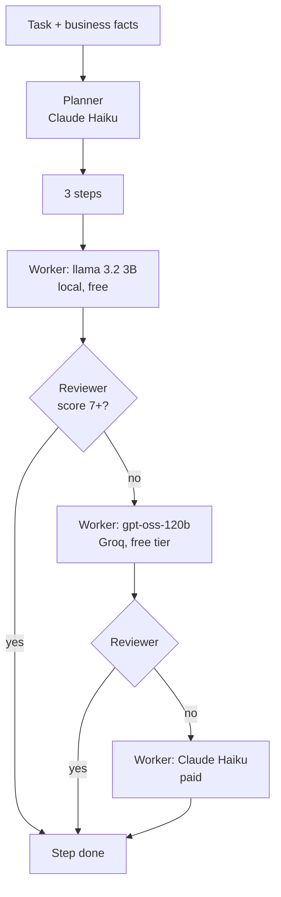

# Agent Lab: Cost-Aware Multi-Agent System

A multi-agent AI system that plans, does and reviews business tasks for small Thai businesses, sending each step to the cheapest model that can do it well. Every change is measured on a fixed eval set.

**Result:** independent judge score improved from **7.4 to 8.4** while the share of steps finished by free models rose from **40% to 47%**.

## How it works



- **Planner** splits the task into 3 steps a text-only AI can complete.
- **Workers** escalate from cheapest to strongest: local llama, then Groq, then Claude.
- **Reviewer** scores each step and sends feedback back to the next worker.
- Workers get the overall goal and the work done so far, so steps build on each other.

## Evaluation

`eval_set.json` holds 5 real-style tasks: a cafe Instagram plan, Thai LINE replies for a salon, a contractor progress email, bilingual guesthouse check-in, and a street food menu.

Each run is scored twice:
- **Reviewer** (Claude): per step, inside the system.
- **Judge** (gpt-oss-120b via Groq): the final work, from a different model family, to reduce self-preference bias.

| Version | Change | Judge avg | Free steps | Claude calls |
| --- | --- | --- | --- | --- |
| v1-baseline | 3-tier escalation | 7.4 | 40% | 52 |
| v2-assumptions | Label every missing fact | 6.0 | 27% | 56 |
| **v3-ready-to-use** | Use given facts, assume only when truly missing, output must be finished | **8.4** | **47%** | **51** |

Full results: `results/history.csv`. Outputs for each case: `results/*.md`.

## What I learned

- **Measure before and after every change.** v2 fixed the weakest case (3 to 8) but broke two others (10 to 5, 9 to 3) by filling messages with placeholders. The eval set caught the regression.
- **Most low scores came from missing input, not weak models.** When a task asked for spice levels or dates it never gave, agents either skipped the requirement or left blanks.
- **Free models can do real work.** gpt-oss-120b on Groq finished the Thai salon task on its own in v3. The 3B local model is reliable only for simple English.
- **Do not trust the model's output format.** I hit tool calls with text instead of numbers, thinking blocks without text, and token limits that cut answers off. Each needed a code fix, not a better prompt.
- **One run is noisy.** Scores move by about 1 point between runs; the next step is averaging several runs per version.

## Project files

| File | Purpose |
| --- | --- |
| `agent_core.py` | Planner, workers, reviewer, escalation (`run_task`) |
| `eval.py` | Runs the eval set, scores with both judges, appends to history |
| `eval_set.json` | The 5 test tasks |
| `local_ai.py` → `multi_agent_v3.py` | Earlier steps, kept to show how the system grew |

## Run it

```bash
python3 -m venv .venv && source .venv/bin/activate
pip install anthropic groq ollama python-dotenv
ollama pull llama3.2
# .env needs ANTHROPIC_API_KEY and GROQ_API_KEY
python eval.py my-version-name
```

## Next

- Retrieval (RAG): give agents a file of real business facts to look up.
- Shared rubric and good examples for workers.
- Average 3 runs per version to reduce noise.

## How this was built

I designed the architecture, the eval set and every change, and wrote the code step by step while learning, with Claude as a tutor. Built in Phuket, Thailand, November 2026.
